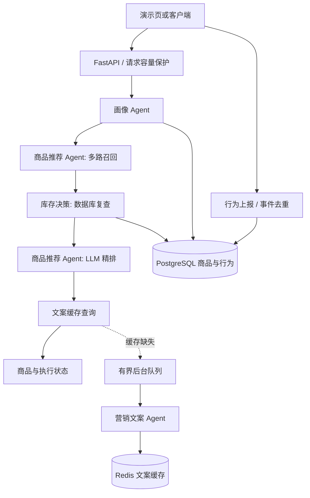

# 架构与设计取舍

Agent 使用固定工作流，便于控制时延和权限；没有自主无限规划。库存是确定性工具能力，不为展示 Agent 而强行调用模型。画像模型只重排已有类目，当前价值有限，应通过后续消融实验验证。

模型网关统一拥有重试、并发限制和熔断；所有输出需通过 schema 和候选校验。业务失败保守降级，数据库初始读取失败返回 503；正常无商品不是异常。每请求独立状态，取消向下传播。

文案与用户画像无关，缓存键只使用模型、Prompt 版本和商品公开信息，因此可跨用户复用。排序顺序改变会产生不同键。后台与前台共享模型并发容量，后续应考虑资源隔离。

指标为有界维度聚合，但仅存在单进程内存。生产需接集中监控、追踪、供应商费用核算和告警。共享 API Key 仅验证调用方，不能代替用户权限。
